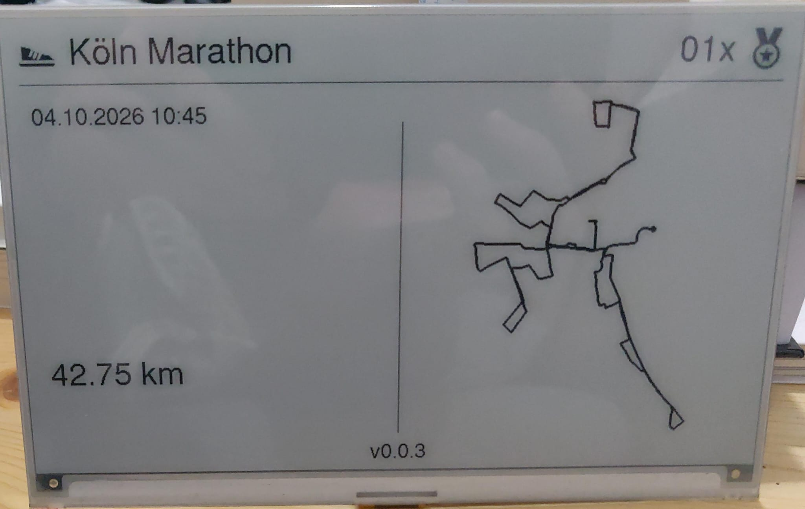

# ePaper-strava-viewer

Show your Strava activities on a Waveshare 7.5" e-Paper display driven by the Waveshare e-Paper ESP32 Driver Board.

## Preview



## Hardware

| Part | Notes |
| --- | --- |
| Waveshare 7.5" e-Paper (V2, 800×480, black/white) | Raw panel with FPC ribbon cable |
| Waveshare e-Paper ESP32 Driver Board | ESP32-WROOM-32, CP2102 USB-UART, onboard 24-pin FPC connector |
| Micro-USB cable | Must be a data cable, not charge-only |
| Pushbutton | Opens the setup page, see [Setup button](#setup-button) |

### Setup button

A pushbutton between **GPIO33** and **GND** wakes the ESP32 from deep sleep and opens the
[setup page](#setup-page). No resistor is needed: the ESP32's internal pull-up stays on during
deep sleep and only draws current while the button is pressed.

```
   ESP32 board
   GPIO33 ────── button ────── GND
```

Another pin works too, as long as it's an RTC GPIO (0, 2, 4, 12–15, 25–27, 32–39) that's still
free: change `BUTTON_PIN` in `firmware/lib/SleepSchedule/src/SleepSchedule.cpp`. GPIO34–39 have no
internal pull-up and need an external 10 kΩ resistor to 3V3.

### Battery power (optional)

| Part | Notes |
| --- | --- |
| Li-Ion cell (3.7 V) | e.g. 18650 |
| TP4056 charging board with protection (DW01) | USB-C, outputs the raw battery voltage (3.0–4.2 V), no boost converter |
| HT7333 LDO regulator | 3.3 V, low dropout, 4 µA quiescent current |
| 2× 10 µF capacitor | Input and output capacitor of the HT7333 |
| 470–1000 µF electrolytic capacitor | Buffers the WiFi current peaks |
| 2× 100 kΩ resistor, 100 nF ceramic capacitor | Voltage divider for measuring the battery voltage |

The charging board's output must **not** go to the driver board's 5V pin. The onboard regulator
drops about 1 V, so the ESP32 gets 3.0 V or less and browns out (or the DW01 cuts the power) as
soon as WiFi starts; the board then stays off and never wakes up from deep sleep. Instead, the
HT7333 powers the **3V3** pin directly:

```
                 TP4056 charging board
   Li-Ion        ┌────────────────────┐
   cell     +────┤ B+            OUT+ ├──────────┬────────────────────┬─────┐
            −────┤ B−            OUT− ├──┐       │ +                  │     │
                 └────────────────────┘  │      ═╪═ C1 10µF           │    ┌┴┐
                                         │       │                    │    │ │ R1 100k
                                         ├───────┘       HT7333       │    └┬┘
                                         │             ┌────────┐     │     ├─────────┬─────────┐
                                         │             │    VIN ├─────┘    ┌┴┐        │         │
                                         ├─────────────┤ GND    │          │ │ R2    ═╪═ C4     │
                                         │             │   VOUT ├─────┐    └┬┘ 100k   │ 100nF   │
                                         │             └────────┘     │     └────┬────┘         │
                                         │                            │         GND             │
                                         │       ┌──────────┬─────────┤                         │
                                         │     + │        + │         │                         │
                                         │      ═╪═ C2     ═╪═ C3     │                         │
                                         │       │  10µF    │  470µF  │                         │
                                         ├───────┴──────────┘         │                         │
                                         │                            │                         │
                 ESP32 e-Paper board     │                            │                         │
                 ┌────────────────────┐  │                            │                         │
                 │ GND    ◄───────────┼──┘                            │                         │
                 │ 3V3    ◄───────────┼───────────────────────────────┘                         │
                 │ GPIO35 ◄───────────┼─────────────────────────────────────────────────────────┘
                 │ 5V/VIN  (unused)   │
                 └────────────────────┘
   "GND" marks a connection to the GND bus. "+" marks the positive capacitor leg
   (polarity matters for the electrolytic C3).
```

- **Pinout:** the TO-92 HT7333-A is **GND – VIN – VOUT** from left to right, looking at the flat,
  printed side with the legs pointing down. Other variants and packages (SOT-89, …) can differ,
  so check the datasheet for the exact part number printed on yours.
- **C1 / C2 (10 µF)** are required by the datasheet, otherwise the regulator can oscillate. Place
  them as close to the pins as possible.
- **C3 (470–1000 µF)** is strongly recommended: the HT7333 is only rated for 250 mA, while the
  ESP32 draws short peaks of about 300–400 mA when WiFi starts. C3 supplies them. If the board
  still resets while connecting to WiFi, use an LDO rated for 500 mA (e.g. MCP1825S-3302, XC6220).
- **Battery voltage (R1, R2, C4):** the divider halves the battery voltage (3.0–4.2 V → 1.5–2.1 V)
  for the ADC. It must sit on VBAT, not on 3V3, and use an ADC1 pin (GPIO 32–39); ADC2 pins don't
  work while WiFi is active. It draws about 21 µA constantly; 2× 220 kΩ halves that. C4 keeps the
  reading stable despite the high resistance, so place it close to the GPIO pin.
- **Disconnect the battery before flashing via USB**, otherwise the onboard regulator and the
  HT7333 both drive the 3V3 rail.
- Below about 3.4 V battery voltage the output follows the battery minus the dropout. The ESP32
  runs down to about 3.0 V, and the DW01 cuts off at about 2.5 V.
- **Check:** about 3.3 V at the 3V3 pin, the board's LED stays on during deep sleep, and the
  display refreshes at the next full hour.

## Software prerequisites

1. **VS Code**: <https://code.visualstudio.com/>
2. **PlatformIO IDE extension**: in VS Code install the Extension.
3. **Git**, to clone this repository.
4. **USB-UART driver** (CP2102):
   - **Linux**: the driver is built into the kernel. Your user needs access to the serial port:
     ```sh
     # Arch Linux
     sudo usermod -aG uucp $USER
     # Debian/Ubuntu
     sudo usermod -aG dialout $USER
     ```
     Log out and back in afterwards. PlatformIO also recommends installing its udev rules: <https://docs.platformio.org/en/latest/core/installation/udev-rules.html>
   - **Windows/macOS**: install the CP210x driver from Silicon Labs: <https://www.silabs.com/developers/usb-to-uart-bridge-vcp-drivers>


### 1. PlatformIO configuration

`platformio.ini`:

```ini
[platformio]
default_envs = esp32dev

[env:esp32dev]
platform = espressif32
board = esp32dev
framework = arduino
monitor_speed = 115200
upload_speed = 921600
board_build.partitions = huge_app.csv

lib_deps =
    zinggjm/GxEPD2
    bblanchon/ArduinoJson

[env:icon-test]
extends = env:esp32dev
build_src_filter = -<*> +<../tools/icon_overview/device/>
```

`esp32dev` is the normal firmware; `icon-test` is a test firmware, see [Testing](#testing).

- **GxEPD2**: e-Paper driver. The 7.5" V2 panel uses the `GxEPD2_750_T7` class.
- **ArduinoJson**: parses the responses from the Strava API.

Minimal display initialisation for this board:

```cpp
#include <SPI.h>
#include <GxEPD2_BW.h>

// CS=15, DC=27, RST=26, BUSY=25
GxEPD2_BW<GxEPD2_750_T7, GxEPD2_750_T7::HEIGHT> display(GxEPD2_750_T7(15, 27, 26, 25));

void setup() {
  SPI.end();
  SPI.begin(13, 12, 14, 15);  // SCK=13, MISO=12 (unused), MOSI=14, SS=15
  display.init(115200, true, 2, false);
  // ... draw
}

void loop() {
  // required by the Arduino framework, even if empty
}
```

### 2. Strava API credentials

1. Log in to Strava and go to <https://www.strava.com/settings/api>.
2. Create an application. Set **Authorization Callback Domain** to `strava-viewer.local`.
3. Open the [setup page](#setup-page) in your WiFi, copy the **Client ID** and **Client Secret**
   into it and click **Connect with Strava**. Authorize the app at Strava (keep *View data about
   your private activities* checked). Strava leads you back to the setup page, which shows
   *Strava is connected (…)*. Click **Save** to show your latest activity.

If the browser shows an error page instead of the setup page after authorizing (some phones can't
open `.local` addresses), open *Strava doesn't lead you back here?* on the setup page and paste
the error page's address there. With `localhost` as callback domain this works too: use
**Authorize via localhost** there.

Without the setup page, e.g. for `secrets.h`, get the refresh token by hand (callback domain
`localhost`):

4. Open this URL in your browser (replace `YOUR_CLIENT_ID`) and authorize the app:
   ```
   https://www.strava.com/oauth/authorize?client_id=YOUR_CLIENT_ID&response_type=code&redirect_uri=http://localhost&approval_prompt=force&scope=read,activity:read,activity:read_all
   ```
5. The browser redirects to `http://localhost/?state=&code=XXXX&scope=...`. The page itself won't load, which is expected. Copy the `code` value from the address bar.
6. Exchange the code for a refresh token:
   ```sh
   curl -X POST https://www.strava.com/oauth/token \
     -d client_id=YOUR_CLIENT_ID \
     -d client_secret=YOUR_CLIENT_SECRET \
     -d code=XXXX \
     -d grant_type=authorization_code
   ```
   Copy the `refresh_token` from the JSON response. The ESP32 uses it to request short-lived access tokens on its own.

### 3. Credentials

Enter the WiFi and Strava credentials on the [setup page](#setup-page), or store them with a local
build: create `firmware/include/secrets.h`:

```cpp
#pragma once

#define WIFI_SSID            "your-wifi-name"
#define WIFI_PASSWORD        "your-wifi-password"

#define STRAVA_CLIENT_ID     "12345"
#define STRAVA_CLIENT_SECRET "your-client-secret"
#define STRAVA_REFRESH_TOKEN "your-refresh-token"
```

The firmware stores these in NVS on start, but only if no credentials are stored yet, so it
doesn't overwrite what was entered on the setup page. After **Reset device** on the setup page, the
same build doesn't store them again, so the reset really deletes them; flashing a new build stores
them again. To store changed values from `secrets.h`: reset the device, then flash the new build.

### Setup page

The device opens a settings page for 10 minutes, with a countdown on the page:

- **when the [setup button](#setup-button) is pressed:** in the normal WiFi if it connects, the
  display shows a QR code with the page's address (or `http://strava-viewer.local`);
- **otherwise, and if no credentials are stored:** in its own WiFi `StravaViewer-XXXX`. The display
  shows a QR code to connect to it, with its name and password, and one for `http://192.168.4.1`,
  which most phones open by themselves after connecting.

The page shows the firmware version, the battery and the connection, and changes the WiFi and
Strava credentials. **Connect with Strava** gets the refresh token from Strava (see
[Strava API credentials](#2-strava-api-credentials)); it needs the page to run in your WiFi. Fields for passwords and secrets stay empty, which keeps the stored value.
**Save** stores the settings, closes the page and shows the latest activity. **Reset device**
deletes all settings (the whole NVS) and restarts. The own WiFi then gets a new password.

If the Strava credentials are missing or rejected after saving or switching the device on, it
opens the setup page in the WiFi right away, with the reason as the heading. During the hourly
updates it only shows the error and that the button opens the setup page. If the WiFi isn't found,
the error screen also shows the QR code for the device's own WiFi. When the 10 minutes end without
saving, the device continues with the settings it has; without WiFi credentials, or without Strava
credentials, it sleeps until the button is pressed.

### 4. Build and upload

1. Connect the driver board via USB.
2. In the PlatformIO toolbar at the bottom of VS Code:
   - ✓ **Build** (`Ctrl+Alt+B`)
   - → **Upload** (`Ctrl+Alt+U`)
   - 🔌 **Serial Monitor**: shows log output at 115200 baud
3. Or from the PlatformIO terminal:
   ```sh
   pio run -t upload
   pio device monitor
   ```

If the upload hangs at `Connecting........`, hold the **BOOT** button on the driver board until the upload starts, then press **EN/RST** after it finishes.

## Testing

### Activity icons

The heading shows an icon for the activity's `sport_type`.

Both test methods draw the same overview: one grid cell per sport type with its icon and name, plus the fallback icon `(other)` and the error icon `(error)`.

#### On the PC (no flashing)

```sh
firmware/tools/icon_overview/pc/run.sh
```

Compiles the icon code for the PC and writes `firmware/tools/icon_overview/pc/build/icon_overview.png` (800×480, like the display). Fast to repeat while designing icons.

Requirements:
- `g++`
- the libraries PlatformIO downloads: run `pio run` in `firmware/` once
- Python 3 with Pillow (`pip install pillow`) for the PNG; without it you get `icon_overview.pbm`, which most image viewers open as well

The script uses small stand-ins for the Arduino core (`firmware/tools/icon_overview/pc/stubs/`) so Adafruit GFX compiles on the PC. The drawing code is the same as on the ESP32, so the image matches the panel pixel for pixel.

#### On the e-paper

```sh
cd firmware
pio run -e icon-test -t upload
```

Flashes a test firmware (`firmware/tools/icon_overview/device/main.cpp`) that draws the overview once and puts the display to sleep. Use this to check the final look on the panel. Afterwards flash the normal firmware again with `pio run -t upload`.

In VS Code you can switch the environment in the PlatformIO toolbar (*Switch PlatformIO Project Environment*) to `env:icon-test` and use Upload as usual.

### Error codes

WiFi and Strava errors are shown on the display and logged with details on the serial monitor (`pio device monitor`), for example:

```
WiFi error 1 (status 1): WiFi network not found
Strava error 1 (HTTP 401): Strava login failed
{"message":"Authorization Error", ...}
```

The numbers are the values of `WifiErrorCode` (`firmware/lib/WifiConnect/src/WifiConnect.h`) and `StravaErrorCode` (`firmware/lib/StravaApi/src/StravaApi.h`). For Strava errors the last line is the response body or the JSON parser error.

## Troubleshooting

| Problem | Fix |
| --- | --- |
| `Permission denied: /dev/ttyUSB0` | Add your user to the serial group (see above) and log in again |
| Display stays white or shows noise | Check that the ribbon cable is seated properly; toggle the Display Config switch between A and B; make sure you use `GxEPD2_750_T7` (V2) and not `GxEPD2_750` (V1) |
| Display is stuck in "busy" (timeout in the log) | Wrong pins: check the BUSY/RST pin mapping and the `SPI.begin(13, 12, 14, 15)` remap |
| Ghosting after many partial refreshes | Do a full refresh regularly (e.g. every 10th update) |
| Strava returns `401 Unauthorized`, or `activity:read_permission` is `missing` | Refresh token is invalid or wasn't allowed to read activities: connect Strava again on the setup page and keep *View data about your activities* checked |
| WiFi doesn't connect | Check SSID/password on the [setup page](#setup-page); use a 2.4 GHz network |
| Setup button does nothing | It only wakes the ESP32 from deep sleep, not while it's loading an activity; check the wiring to GPIO33 |
